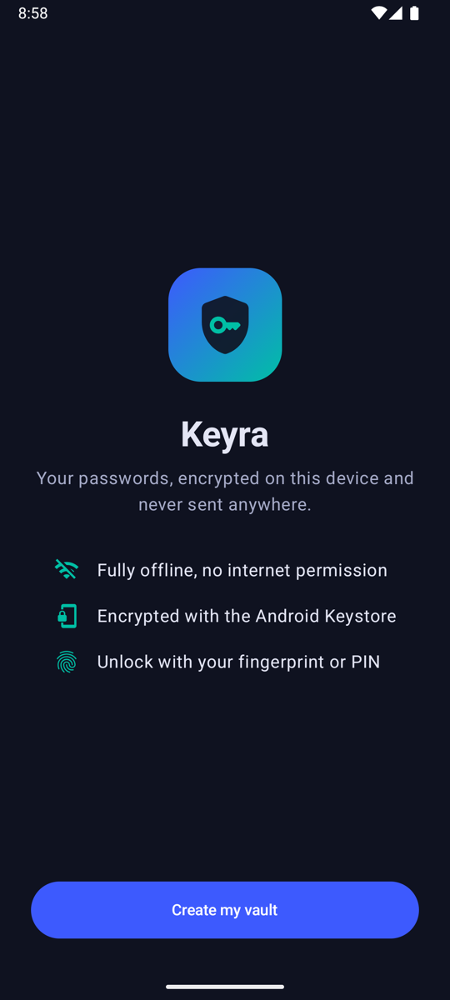
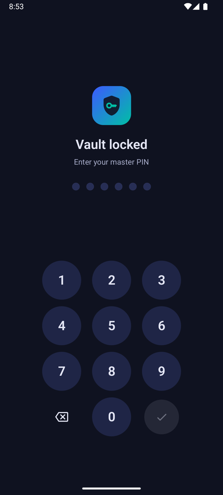
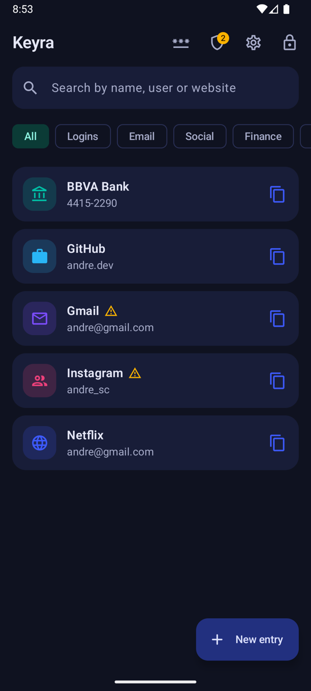
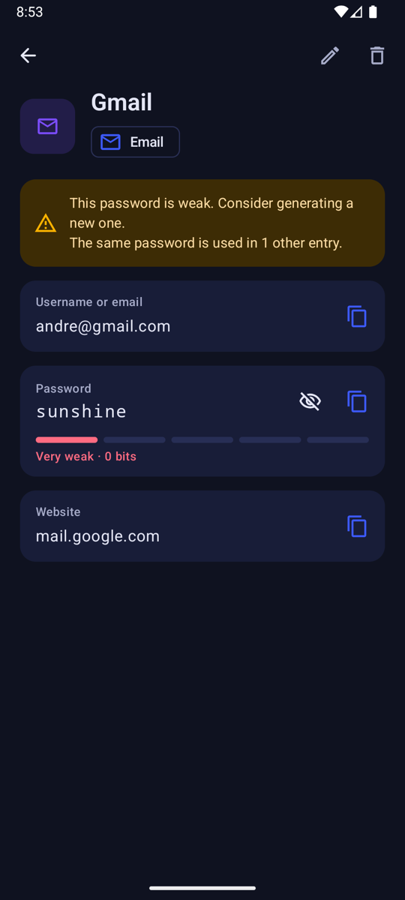
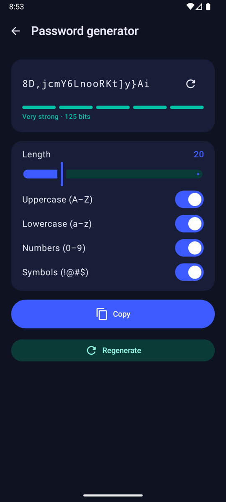
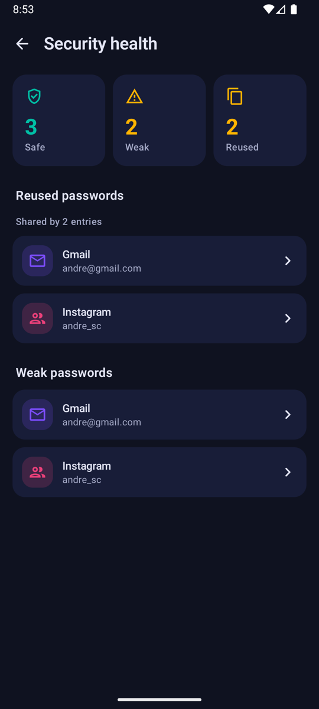
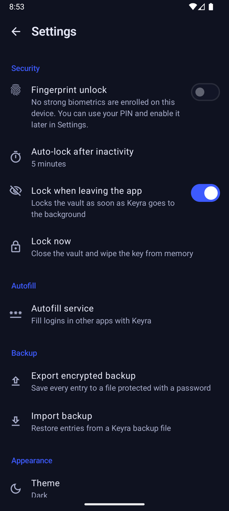
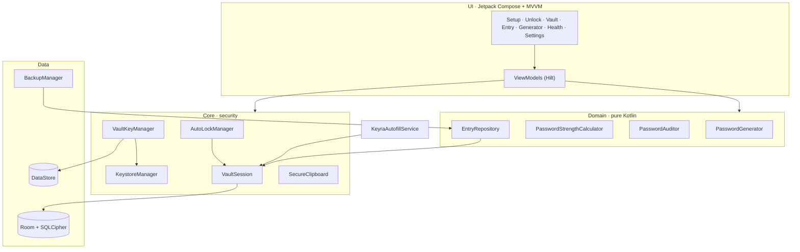
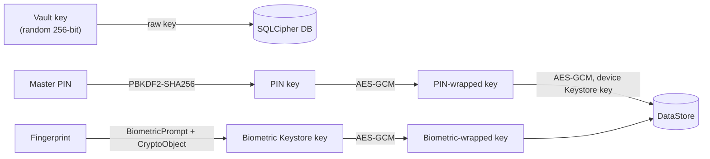

# Keyra

[](https://github.com/AndreSC1812/Keyra/actions/workflows/ci.yml)


[](LICENSE)

Keyra is an offline password manager for Android: a local vault encrypted with a key from the Android Keystore, unlocked with your fingerprint or a master PIN, and without internet access.

## Screenshots

### Welcome & Unlock Screens
 

### Vault & Entry Detail Screens
 

### Password Generator & Security Health Screens
 

### Settings Screen


## Tech Stack

- **[Kotlin](https://developer.android.com/kotlin):** Modern language for Android development.

- **[Jetpack Compose](https://developer.android.com/jetpack/compose) & [Material 3](https://m3.material.io/):** Declarative UI with a dark-first theme.

- **[Hilt](https://dagger.dev/hilt/):** Dependency injection library for clean and modular code.

- **[Room](https://developer.android.com/training/data-storage/room) + [SQLCipher](https://www.zetetic.net/sqlcipher/):** Local database encrypted with AES-256.

- **[Android Keystore](https://developer.android.com/privacy-and-security/keystore) & [AndroidX Biometric](https://developer.android.com/jetpack/androidx/releases/biometric):** Hardware-backed keys unlocked through `BiometricPrompt` with a `CryptoObject`.

- **[DataStore](https://developer.android.com/topic/libraries/architecture/datastore):** User settings and the wrapped (encrypted) copies of the vault key.

- **[Autofill Framework](https://developer.android.com/identity/autofill/autofill-services):** Fills usernames and passwords in other apps.

- **[Kotlin Coroutines & Flow](https://kotlinlang.org/docs/coroutines-overview.html):** Reactive streams from the database to the UI.

- **[Kotlinx Serialization](https://github.com/Kotlin/kotlinx.serialization):** Type-safe navigation routes and the backup format.

- **Quality:** JUnit, Turbine, detekt, Android Lint and GitHub Actions.

- **Clean Architecture, SOLID Principles, MVVM:** Design approach for maintainable and scalable code.

- **GitFlow:** Git branching model for project release management.

## Architecture



### How the vault is protected



- A random 256-bit vault key encrypts the SQLCipher database. It is never stored in plain text.
- The **biometric path** wraps it with an AES-256-GCM Keystore key that requires strong biometric authentication for every use and is **invalidated when a new fingerprint is enrolled**.
- The **PIN path** wraps it with a key derived from the PIN (PBKDF2), wrapped again with a device-bound Keystore key so it cannot be brute-forced off the device. Wrong PINs trigger an exponential lockout.
- Locking closes the database and wipes the key from memory.

## How to Run the Project

1. Clone this repository to your local machine.
2. Open the project in Android Studio.
3. Connect your Android device or use an emulator (API 26+).
4. Build and run the project.

You can also download the latest APK from [Releases](https://github.com/AndreSC1812/Keyra/releases).

## Configuration

No API keys are needed and the app never connects to the internet.

- **Biometrics on an emulator:** set a screen lock, enroll a fingerprint in the system settings and simulate a touch with:

```plaintext
adb -e emu finger touch 1
```

- **Screenshots:** every screen uses `FLAG_SECURE`. To capture images for documentation, install a debug build with:

```plaintext
./gradlew installDebug -Pkeyra.allowScreenshots=true
```

- **Release signing:** the release workflow reads the keystore from the `KEYRA_KEYSTORE_BASE64`, `KEYRA_KEYSTORE_PASSWORD`, `KEYRA_KEY_ALIAS` and `KEYRA_KEY_PASSWORD` GitHub secrets. Nothing secret lives in the repository.

## Features

- **Initial Setup:** Create a master PIN and enable fingerprint unlock in a short guided flow.

- **Biometric Unlock:** `BiometricPrompt` with a `CryptoObject`: the fingerprint unlocks the Keystore key that decrypts the vault key.

- **Entries:** Create, edit and delete entries with title, username, password, website, notes and category.

- **Search & Filters:** Search by name, username or website and filter by category.

- **Password Generator:** Choose length, uppercase, lowercase, numbers and symbols, with a live strength meter. Uses `SecureRandom`.

- **Secure Clipboard:** Copied secrets are flagged as sensitive and wiped automatically after 30 seconds.

- **Auto-lock:** The vault locks when the app goes to the background or after a configurable period of inactivity.

- **Security Health:** Warnings for weak and reused passwords, with a dedicated report screen.

- **Autofill Service:** Fill usernames and passwords in other apps and websites, after unlocking the vault.

- **Encrypted Backups:** Export and import the vault as a file encrypted with AES-256-GCM and a password of your choice.

- **Security by Design:** No `INTERNET` permission, `FLAG_SECURE` on every screen, no cloud backup of the vault and passwords never written to logs (log calls are stripped from release builds).

## Contributing

We welcome contributions! If you want to contribute to Keyra, please fork the repository and create a pull request. For major changes, please open an issue first to discuss the proposed changes.

License
--------

    MIT License
    Copyright (c) 2026 André Salazar
    Permission is hereby granted, free of charge, to any person obtaining a copy
    of this software and associated documentation files (the "Software"), to deal
    in the Software without restriction, including without limitation the rights
    to use, copy, modify, merge, publish, distribute, sublicense, and/or sell
    copies of the Software, and to permit persons to whom the Software is
    furnished to do so, subject to the following conditions:

    The above copyright notice and this permission notice shall be included in all
    copies or substantial portions of the Software.

    THE SOFTWARE IS PROVIDED "AS IS", WITHOUT WARRANTY OF ANY KIND, EXPRESS OR
    IMPLIED, INCLUDING BUT NOT LIMITED TO THE WARRANTIES OF MERCHANTABILITY,
    FITNESS FOR A PARTICULAR PURPOSE AND NONINFRINGEMENT. IN NO EVENT SHALL THE
    AUTHORS OR COPYRIGHT HOLDERS BE LIABLE FOR ANY CLAIM, DAMAGES OR OTHER
    LIABILITY, WHETHER IN AN ACTION OF CONTRACT, TORT OR OTHERWISE, ARISING FROM,
    OUT OF OR IN CONNECTION WITH THE SOFTWARE OR THE USE OR OTHER DEALINGS IN THE
    SOFTWARE.
